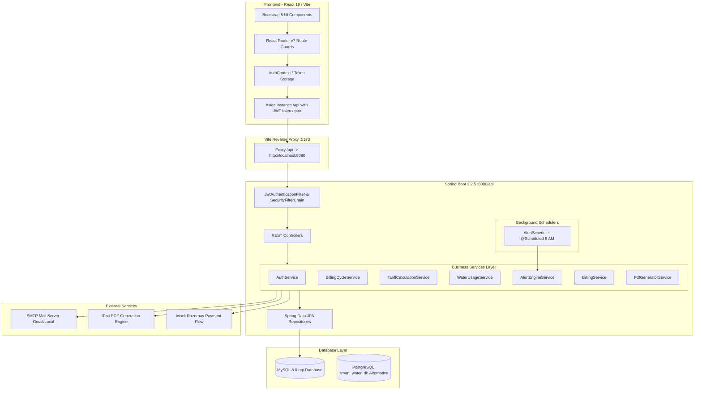
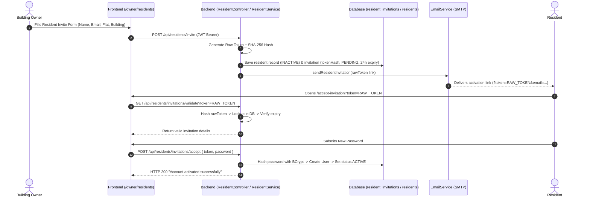
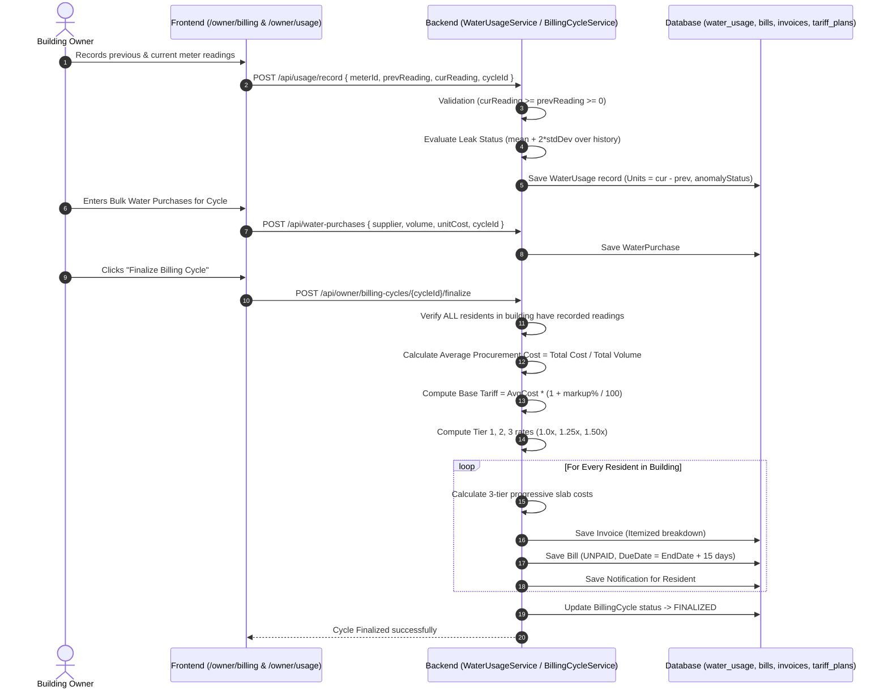
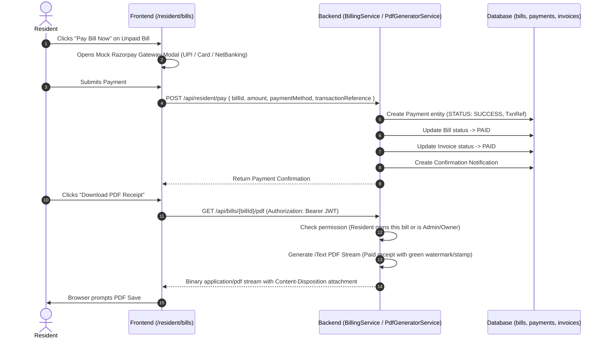
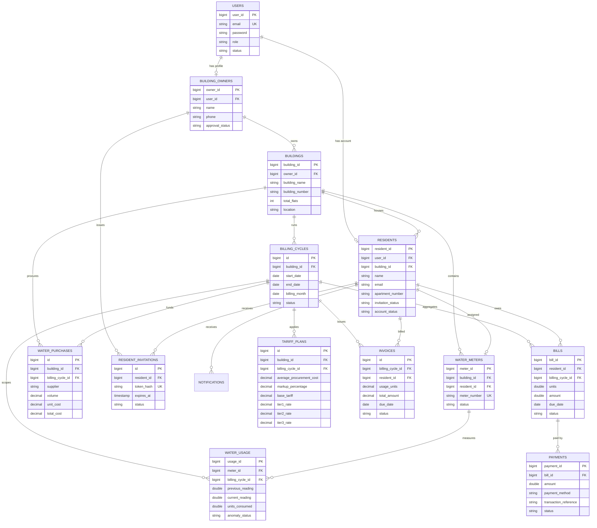

# PROJECT HANDOVER REPORT: Smart Water Billing and Management System (AquaFlow)

**Document Version:** 1.0.0  
**Generated On:** 2026-10-13  
**Analysis Author:** Senior Software Architect, Repository Analyst & Technical Documentation Engineer  
**Target Audience:** Engineering Team, AI Assistants, System Architects, Quality Assurance  

---

## 1. Executive Summary

The **Smart Water Billing and Management System (AquaFlow)** is a full-stack, enterprise-style web application designed for residential societies, apartment complexes, and gated communities. Its primary objective is to solve bulk-water procurement tracking, automated fair-share and tiered consumption billing, automated meter logging, resident account security, and water leakage anomaly detection.

The codebase comprises:
1. **Backend:** Java 17 / 25, Spring Boot 3.2.5, Spring Data JPA / Hibernate, Spring Security with stateless JWT (`jjwt 0.11.5`), BCrypt password hashing, and iText 5.5.13 PDF generation.
2. **Frontend:** React 19.0.0, Vite 6.0.0, React Router v7.1.0, Bootstrap 5.3.3, Recharts 3.10.1, Axios 1.7.2.
3. **Database Architecture:** Dual database compatibility: MySQL 8.0 (currently active and verified in local environment) and PostgreSQL (defined in Flyway/SQL migration files `V1`–`V8`), with optional H2 in-memory testing profile (`application-h2.yml`).
4. **Current Implementation Reality:** The application is feature-rich and actively runnable. End-to-end flows for Super Admin governance, Building Owner cycle/procurement/meter operations, and Resident bill viewing/mock payment/PDF generation are implemented in both frontend and backend. However, no automated unit or integration tests exist in either `backend/src/test` or `frontend/`, payment processing is currently a mock simulation of Razorpay, and database migrations are split between PostgreSQL DDL scripts and Hibernate DDL generation on MySQL.

---

## 2. Project Purpose and Requirements

### 2.1 The Core Problem Solved
In multi-unit residential communities and commercial complexes:
- Water is sourced from multiple suppliers (municipal supply, private water tankers, borewells) at varying costs.
- Buildings lack mechanisms to equitably allocate dynamic procurement costs across residents based on actual consumption.
- Manual billing leads to delayed collections, lack of transparency, and failure to detect leaks or burst pipes before water and money are wasted.
- Resident onboarding is traditionally uncoordinated, lacking secure, token-based verification.

### 2.2 System Roles & Implemented Access Control Matrix
The system enforces strict Role-Based Access Control (**RBAC**) across three user tiers:

| Role | System Scope | Creation Mechanism | Capabilities Implemented |
| :--- | :--- | :--- | :--- |
| **`SUPER_ADMIN`** | System-Wide | Pre-seeded inside database ([DataInitializer.java](file:///p:/REP/backend/src/main/java/com/smartwater/billing/config/DataInitializer.java#L44-L60)). Cannot self-register. | Approve/reject building owners, inspect global metrics (total owners, revenue, pending requests, total buildings/residents). |
| **`BUILDING_OWNER`** | Building-Specific Scope | Public registration form (`/register-owner`). Starts in `PENDING` state. | Manages owned buildings, invites residents, records water meter readings, enters bulk water purchases, configures billing cycles, finalizes 3-tier bills, monitors consumption anomalies. |
| **`RESIDENT`** | Apartment/Flat Scope | Created **strictly** via Building Owner tokenized invitation link. Starts in `INACTIVE` / `PENDING` state. | Activates account via token link, monitors monthly consumption, compares usage against building average, pays bills online (mock gateway), downloads official PDF statements, receives leak/overusage alerts. |

---

## 3. Technology Stack

### 3.1 Core Technologies Table

| Layer | Technology | Version | Purpose in Project |
| :--- | :--- | :--- | :--- |
| **Backend Language** | Java (JDK 17 target / compiled on JDK 25) | 17 (target) | Core backend language |
| **Backend Framework** | Spring Boot | 3.2.5 | MVC REST framework, dependency injection, JPA repository management |
| **Security & Auth** | Spring Security + JJWT | JJWT 0.11.5 | Stateless JWT authentication, role guards (`@PreAuthorize`) |
| **Password Hashing** | BCrypt (`BCryptPasswordEncoder`) | Standard | Salted password hashing (strength 10) |
| **ORM / Persistence** | Spring Data JPA / Hibernate | 3.2.5 / 6.4.4 | Object-relational mapping, schema generation |
| **Database Engines** | MySQL & PostgreSQL | MySQL 8.0 (Active), PostgreSQL 14+ (Schema scripts) | Primary relational data storage |
| **Document Engine** | iText PDF | 5.5.13.3 | Dynamic PDF generation for bill invoices and payment receipts |
| **Frontend Framework** | React | 19.0.0 | Component-based single-page application |
| **Build Tool & Dev Server**| Vite | 6.0.0 (Vite v6.4.3 runtime) | Hot-module replacement, bundling, `/api` proxying |
| **Client Routing** | React Router DOM | 7.1.0 | Declarative client routing and route-level role guarding |
| **Styling & Icons** | Bootstrap & Bootstrap Icons | 5.3.3 / 1.11.3 | Responsive UI design, grid layout, UI components |
| **Data Visualization** | Recharts | 3.10.1 | Responsive bar charts for household consumption benchmarking |
| **HTTP Client** | Axios | 1.7.2 | Interceptor-based HTTP client managing JWT headers & 401 handling |
| **API Documentation** | Springdoc OpenAPI / Swagger UI | 2.5.0 | Interactive API testing documentation at `/api/swagger-ui.html` |

---

## 4. Repository Structure

```
p:/REP/
├── README.md                                          # Original repository documentation
├── setup-db.ps1                                       # PowerShell script for PostgreSQL recreation & seeding
├── setup-db.bat                                       # Windows Batch script for PostgreSQL setup
├── Smart_Water_Billing_System.postman_collection.json # Postman API collection for all 3 roles
├── Smart_Water_Billing_System_Owner_Architecture_Document.docx # Architecture specification
├── backend/                                           # Spring Boot Backend Service
│   ├── pom.xml                                        # Maven project descriptor & dependencies
│   ├── seed_clean_sample_data.sql                     # PostgreSQL table truncation & seed script
│   └── src/
│       └── main/
│           ├── java/com/smartwater/billing/
│           │   ├── SmartWaterApplication.java         # Main Spring Boot Application entrypoint (@EnableScheduling)
│           │   ├── config/                            # Security, CORS, JWT, Swagger, Seed Data
│           │   │   ├── CorsConfig.java                # Global CORS configuration (allows localhost:5173)
│           │   │   ├── CustomUserDetailsService.java  # Loads UserDetails by email from UserRepository
│           │   │   ├── DataInitializer.java           # Seeds Super Admin, Owners, Buildings, Residents, Tariffs
│           │   │   ├── JwtAuthenticationFilter.java   # Bearer token extractor & SecurityContext setter
│           │   │   ├── JwtUtils.java                  # HMAC-SHA token generator, parser & validator
│           │   │   ├── SecurityConfig.java            # Spring Security Filter Chain & URL rules
│           │   │   └── SwaggerConfig.java             # OpenAPI documentation metadata
│           │   ├── controller/                        # 13 REST Controllers
│           │   │   ├── AuthController.java            # Login, owner registration, token acceptance
│           │   │   ├── BillController.java            # Bill generation, PDF download, invoice summaries
│           │   │   ├── BillingCycleController.java    # Cycle creation, finalization, archiving
│           │   │   ├── BuildingOwnerController.java   # Owner dashboard, building CRUD, resident listing
│           │   │   ├── NotificationController.java    # Notification fetch & mark read
│           │   │   ├── PurchaseController.java        # Bulk water purchase tracking & cost summary
│           │   │   ├── ResidentController.java        # Resident invitation, dashboard, bills, payment
│           │   │   ├── SuperAdminController.java      # Admin metrics, owner approve/reject
│           │   │   ├── TariffController.java          # Tariff plan creation, dynamic markup update
│           │   │   ├── TariffPlanController.java      # Marker class delegating to TariffController
│           │   │   ├── UserController.java            # Profile viewing, profile update, password change
│           │   │   ├── WaterPurchaseController.java   # Marker class delegating to PurchaseController
│           │   │   └── WaterUsageController.java      # Meter reading recording & retrieval
│           │   ├── dto/                               # Data Transfer Objects
│           │   │   ├── AuthDTOs.java                  # Login, registration, token request/response models
│           │   │   ├── BillingDTOs.java               # Bill response, payment request, invoice summary
│           │   │   ├── BillingEngineDTOs.java         # Tariff recommendation & purchase summaries
│           │   │   ├── BuildingDTOs.java              # Building creation & response models
│           │   │   ├── DashboardDTOs.java             # Admin, Owner, Resident dashboard metric objects
│           │   │   ├── HouseholdDTOs.java             # Household usage comparison models
│           │   │   ├── ResidentDTOs.java              # Invitation & resident update requests
│           │   │   ├── UsageDTOs.java                 # Meter reading request/response DTOs
│           │   │   └── UserDTOs.java                  # User profile & password update models
│           │   ├── entity/                            # JPA Hibernate Entities (15 tables)
│           │   │   ├── Bill.java                      # Billing statement entity (snapshot of charges)
│           │   │   ├── BillingCycle.java              # Monthly billing container for a building
│           │   │   ├── Building.java                  # Apartment building entity
│           │   │   ├── BuildingOwner.java             # Owner profile linked to User
│           │   │   ├── Invoice.java                   # Itemized invoice entity
│           │   │   ├── Notification.java              # System alert / notification entity
│           │   │   ├── Payment.java                   # Payment transaction record
│           │   │   ├── Resident.java                  # Resident apartment profile
│           │   │   ├── ResidentInvitation.java        # Secure tokenized resident invitation tracking
│           │   │   ├── Tariff.java                    # Legacy fixed tariff tier entity
│           │   │   ├── TariffPlan.java                # Dynamic 3-tier tariff plan entity
│           │   │   ├── User.java                      # Core credentials entity with Role & Status
│           │   │   ├── WaterMeter.java                # Physical water meter assigned to apartment
│           │   │   ├── WaterPurchase.java             # Bulk water procurement record
│           │   │   └── WaterUsage.java                # Monthly meter reading & anomaly state
│           │   ├── exception/                         # Global Error Handling
│           │   │   ├── BadRequestException.java       # HTTP 400
│           │   │   ├── GlobalExceptionHandler.java    # Handles validation, duplicate keys, 404, 500
│           │   │   ├── ResourceNotFoundException.java # HTTP 404
│           │   │   └── UnauthorizedException.java     # HTTP 401
│           │   ├── repository/                        # Spring Data JPA Repositories (14 interfaces)
│           │   ├── scheduler/                         # Automated background cron jobs
│           │   │   └── AlertScheduler.java            # Daily 8:00 AM leak audit and over-usage check
│           │   ├── service/                           # Business logic layer (19 services)
│           │   │   ├── AlertEngineService.java        # Leak detection statistics (mean + 2*stdDev)
│           │   │   ├── AuthService.java               # Authentication, registration, token verification
│           │   │   ├── BillingCycleService.java       # Cycle lifecycle & 3-tier bill batch calculation
│           │   │   ├── BillingService.java            # Bill generation, invoice summary, payment handling
│           │   │   ├── BuildingOwnerService.java      # Owner dashboards & building management
│           │   │   ├── DistributionService.java       # Equal & usage-weighted cost distribution
│           │   │   ├── EmailService.java              # JavaMailSender invitation & alert delivery
│           │   │   ├── InvoiceService.java            # Invoice retrieval per cycle
│           │   │   ├── PdfGeneratorService.java       # iText PDF document generator
│           │   │   ├── ResidentService.java           # Resident invites, token hashing, metrics
│           │   │   ├── SuperAdminService.java         # Global metrics & owner approval workflows
│           │   │   ├── TariffCalculationService.java  # Dynamic tariff generator based on purchases
│           │   │   ├── TariffPlanService.java         # Tariff CRUD and cycle assignment
│           │   │   ├── TariffRecommendationService.java # Wastage (10%) & margin (15%) advisor
│           │   │   ├── UserService.java               # Profile updates & password hashing
│           │   │   ├── WaterPurchaseCostService.java  # Procurement aggregations
│           │   │   ├── WaterPurchaseService.java      # Purchase logging & cycle assignment
│           │   │   └── WaterUsageService.java         # Meter reading logging & validation
│           │   └── util/
│           │       └── TokenGenerator.java            # Secure random token & SHA-256 hashing
│           └── resources/
│               ├── application.yml                    # Main Spring Boot configuration (MySQL active)
│               ├── application-h2.yml                 # H2 in-memory testing profile
│               └── db/migration/                      # PostgreSQL Flyway SQL migrations (V1 to V8)
└── frontend/                                          # React 19 Frontend Single Page App
    ├── package.json                                   # NPM dependencies & build scripts
    ├── vite.config.js                                 # Vite config with /api proxy to localhost:8080
    ├── index.html                                     # HTML5 shell with Google Fonts & Bootstrap Icons
    └── src/
        ├── App.jsx                                    # Router definition & layout bindings
        ├── index.css                                  # Custom CSS styling tokens & glassmorphism
        ├── main.jsx                                   # React DOM root render
        ├── components/
        │   ├── LoadingSpinner.jsx                     # Reusable loading animation
        │   ├── Navbar.jsx                             # Top navigation bar with user profile & logout
        │   ├── Sidebar.jsx                            # Role-filtered navigation links
        │   ├── StatCard.jsx                           # Dashboard statistic summary card
        │   └── WaterSavingTips.jsx                    # Conservation advice widget
        ├── context/
        │   └── AuthContext.jsx                        # User authentication state & localStorage sync
        ├── data/
        │   └── waterSavingTips.js                     # Static water saving tips data
        ├── layouts/
        │   ├── DashboardLayout.jsx                    # Authenticated layout with Navbar & Sidebar
        │   └── PublicLayout.jsx                       # Unauthenticated header layout
        ├── pages/
        │   ├── Admin/                                 # Super Admin pages (Dashboard, Owners, Approvals)
        │   ├── Common/                                # Profile & Invoices pages
        │   ├── Owner/                                 # Owner pages (Buildings, Residents, Usage, Billing)
        │   ├── Public/                                # Landing, Login, Registration, Invitation Accept
        │   └── Resident/                              # Resident pages (Dashboard, Bills, Peer Comparison)
        └── services/
            └── api.js                                 # Central Axios client with JWT interceptor
```

---

## 5. Architecture Overview

### 5.1 Architecture Diagram



---

## 6. End-to-End Project Flow

### 6.1 Flow 1: Resident Invitation and Account Activation
Building owners invite residents using tokenized one-time links rather than manual password entry.



### 6.2 Flow 2: Monthly Meter Reading, Anomaly Detection & Bill Finalization
Owners record meter readings for an open billing cycle. The system verifies meter readings, checks for leaks, dynamically calculates tariffs from bulk purchases, and produces itemized invoices.



### 6.3 Flow 3: Resident Payment & PDF Invoice Download



---

## 7. Component Connection Table

| Component | Responsibility | Input | Processing | Output | Connected Components | Status | Evidence (file/line) |
| :--- | :--- | :--- | :--- | :--- | :--- | :--- | :--- |
| **`JwtAuthenticationFilter`** | Intercepts HTTP requests, validates JWT header | HTTP Authorization header | Decodes bearer token via HMAC-SHA secret, loads `UserDetails` | Populates Spring `SecurityContext` | [SecurityConfig.java](file:///p:/REP/backend/src/main/java/com/smartwater/billing/config/SecurityConfig.java), [JwtUtils.java](file:///p:/REP/backend/src/main/java/com/smartwater/billing/config/JwtUtils.java) | **Implemented** | [JwtAuthenticationFilter.java:L27-58](file:///p:/REP/backend/src/main/java/com/smartwater/billing/config/JwtAuthenticationFilter.java#L27-L58) |
| **`AuthController`** | Handles authentication & registration endpoints | JSON `LoginRequest`, `RegisterOwnerRequest`, `SetPasswordRequest` | Validates role match, delegates to `AuthService` and `ResidentService` | JWT token, user metadata, or confirmation message | [AuthService.java](file:///p:/REP/backend/src/main/java/com/smartwater/billing/service/AuthService.java), [ResidentService.java](file:///p:/REP/backend/src/main/java/com/smartwater/billing/service/ResidentService.java) | **Implemented** | [AuthController.java:L19-38](file:///p:/REP/backend/src/main/java/com/smartwater/billing/controller/AuthController.java#L19-L38) |
| **`SuperAdminService`** | Super Admin management & owner approval | Owner ID, approval action | Changes `approvalStatus` to `APPROVED` or `REJECTED`, updates user status | `BuildingOwnerDTO`, `AdminDashboardStats` | [BuildingOwnerRepository.java](file:///p:/REP/backend/src/main/java/com/smartwater/billing/repository/BuildingOwnerRepository.java), [UserRepository.java](file:///p:/REP/backend/src/main/java/com/smartwater/billing/repository/UserRepository.java) | **Implemented** | [SuperAdminService.java:L24-74](file:///p:/REP/backend/src/main/java/com/smartwater/billing/service/SuperAdminService.java#L24-L74) |
| **`ResidentService`** | Resident management, invitation token generation & verification | Resident invite payload, raw tokens | Generates SHA-256 token hash, schedules 24h expiration, creates meter | `ResidentResponse`, `ValidateInvitationResponse` | [TokenGenerator.java](file:///p:/REP/backend/src/main/java/com/smartwater/billing/util/TokenGenerator.java), [EmailService.java](file:///p:/REP/backend/src/main/java/com/smartwater/billing/service/EmailService.java), [ResidentInvitationRepository.java](file:///p:/REP/backend/src/main/java/com/smartwater/billing/repository/ResidentInvitationRepository.java) | **Implemented** | [ResidentService.java:L105-200](file:///p:/REP/backend/src/main/java/com/smartwater/billing/service/ResidentService.java#L105-L200) |
| **`WaterUsageService`** | Records water meter readings & runs leak validation | Previous & Current meter readings | Checks `cur >= prev >= 0`, verifies cycle is OPEN, computes units, calls `AlertEngineService` | `UsageResponse` | [WaterMeterRepository.java](file:///p:/REP/backend/src/main/java/com/smartwater/billing/repository/WaterMeterRepository.java), [AlertEngineService.java](file:///p:/REP/backend/src/main/java/com/smartwater/billing/service/AlertEngineService.java) | **Implemented** | [WaterUsageService.java:L30-100](file:///p:/REP/backend/src/main/java/com/smartwater/billing/service/WaterUsageService.java#L30-L100) |
| **`AlertEngineService`** | Statistical anomaly detection & leak audit | Meter ID, current units | Calculates historical mean $\mu$ and std dev $\sigma$; flags `POTENTIAL_LEAK` if units > $\mu + 2\sigma$ and > 10 kL | Status string (`POTENTIAL_LEAK`, `NORMAL`, `INSUFFICIENT_HISTORY`) | [WaterUsageRepository.java](file:///p:/REP/backend/src/main/java/com/smartwater/billing/repository/WaterUsageRepository.java), [NotificationRepository.java](file:///p:/REP/backend/src/main/java/com/smartwater/billing/repository/NotificationRepository.java), [EmailService.java](file:///p:/REP/backend/src/main/java/com/smartwater/billing/service/EmailService.java) | **Implemented** | [AlertEngineService.java:L28-51](file:///p:/REP/backend/src/main/java/com/smartwater/billing/service/AlertEngineService.java#L28-L51) |
| **`AlertScheduler`** | Background cron task | None (triggered by Spring container) | Runs daily at 08:00 AM (`@Scheduled(cron = "0 0 8 * * *")`) | Dispatches over-usage and leak notifications | [AlertEngineService.java](file:///p:/REP/backend/src/main/java/com/smartwater/billing/service/AlertEngineService.java) | **Implemented** | [AlertScheduler.java:L17-23](file:///p:/REP/backend/src/main/java/com/smartwater/billing/scheduler/AlertScheduler.java#L17-L23) |
| **`TariffCalculationService`** | Computes 3-tier rates from bulk water purchases | BillingCycle entity, optional markup % | Aggregates volume & costs, calculates average cost per kL, applies markup, sets Tier 1/2/3 multipliers (1.0x, 1.25x, 1.5x) | `TariffPlan` entity | [WaterPurchaseRepository.java](file:///p:/REP/backend/src/main/java/com/smartwater/billing/repository/WaterPurchaseRepository.java), [TariffPlanRepository.java](file:///p:/REP/backend/src/main/java/com/smartwater/billing/repository/TariffPlanRepository.java) | **Implemented** | [TariffCalculationService.java:L34-97](file:///p:/REP/backend/src/main/java/com/smartwater/billing/service/TariffCalculationService.java#L34-L97) |
| **`BillingCycleService`** | Manages cycle lifecycle and executes batch billing | Building ID, dates, cycle ID | Validates all residents have readings, applies 3-tier progressive calculation, creates Bills & Invoices | `BillingCycle`, `Invoice`, `Bill` entities | [TariffCalculationService.java](file:///p:/REP/backend/src/main/java/com/smartwater/billing/service/TariffCalculationService.java), [InvoiceRepository.java](file:///p:/REP/backend/src/main/java/com/smartwater/billing/repository/InvoiceRepository.java), [BillRepository.java](file:///p:/REP/backend/src/main/java/com/smartwater/billing/repository/BillRepository.java) | **Implemented** | [BillingCycleService.java:L73-200](file:///p:/REP/backend/src/main/java/com/smartwater/billing/service/BillingCycleService.java#L73-L200) |
| **`BillingService`** | Single bill generation, status update, invoice summaries, payments | Resident ID, Bill ID, Payment details | Calculates amounts, records payment, updates bill/invoice status to `PAID` | `BillResponse`, `PaymentResponse`, `InvoiceDashboardSummary` | [PaymentRepository.java](file:///p:/REP/backend/src/main/java/com/smartwater/billing/repository/PaymentRepository.java), [BillRepository.java](file:///p:/REP/backend/src/main/java/com/smartwater/billing/repository/BillRepository.java) | **Implemented** | [BillingService.java:L118-174](file:///p:/REP/backend/src/main/java/com/smartwater/billing/service/BillingService.java#L118-L174) |
| **`PdfGeneratorService`** | Generates official PDF bills and payment receipts | `Bill` entity | Compiles A4 PDF using iText tables, stamps, and payment references | `ByteArrayInputStream` PDF stream | [Bill.java](file:///p:/REP/backend/src/main/java/com/smartwater/billing/entity/Bill.java), [Payment.java](file:///p:/REP/backend/src/main/java/com/smartwater/billing/entity/Payment.java) | **Implemented** | [PdfGeneratorService.java:L23-130](file:///p:/REP/backend/src/main/java/com/smartwater/billing/service/PdfGeneratorService.java#L23-L130) |
| **`Frontend API Client`** | Global Axios instance | Request configs, URLs, params | Attaches JWT Bearer token from `localStorage('jwtToken')`, catches 401 and clears credentials | Promise resolving HTTP response | [AuthContext.jsx](file:///p:/REP/frontend/src/context/AuthContext.jsx), All Page components | **Implemented** | [api.js:L10-34](file:///p:/REP/frontend/src/services/api.js#L10-L34) |

---

## 8. Feature-by-Feature Implementation Status

| Feature Name | Intended Behavior | Source Files / Classes | Status | Evidence / Verification | Missing Parts / Known Limitations |
| :--- | :--- | :--- | :--- | :--- | :--- |
| **Role-Based Auth (JWT)** | Authenticate Super Admin, Building Owner, and Resident. Enforce route security. | [AuthController.java](file:///p:/REP/backend/src/main/java/com/smartwater/billing/controller/AuthController.java), [AuthService.java](file:///p:/REP/backend/src/main/java/com/smartwater/billing/service/AuthService.java), [SecurityConfig.java](file:///p:/REP/backend/src/main/java/com/smartwater/billing/config/SecurityConfig.java) | **Implemented** | Verified via live HTTP POST `/api/auth/login` returning HTTP 200 with JWT bearer token. | Refresh token mechanism not implemented; tokens expire strictly after 24 hours. |
| **Super Admin Governance** | View system statistics, list building owners, approve or reject pending owners. | [SuperAdminController.java](file:///p:/REP/backend/src/main/java/com/smartwater/billing/controller/SuperAdminController.java), [AdminDashboard.jsx](file:///p:/REP/frontend/src/pages/Admin/AdminDashboard.jsx) | **Implemented** | Controller endpoints and frontend UI cards/actions exist and connect to backend. | No batch approval feature; approvals done one owner at a time. |
| **Building Owner Registration** | Self-register owner account in `PENDING` status. Block login until approved. | [AuthController.java:L25](file:///p:/REP/backend/src/main/java/com/smartwater/billing/controller/AuthController.java#L25), [AuthService.java:L48-53](file:///p:/REP/backend/src/main/java/com/smartwater/billing/service/AuthService.java#L48-L53), [RegisterOwnerPage.jsx](file:///p:/REP/frontend/src/pages/Public/RegisterOwnerPage.jsx) | **Implemented** | Code explicitly throws `BadRequestException("pending approval")` on pending login. | None. |
| **Tokenized Resident Invitation** | Invite resident via email link, SHA-256 token hashing, 24h expiration, set password. | [ResidentService.java:L105-180](file:///p:/REP/backend/src/main/java/com/smartwater/billing/service/ResidentService.java#L105-L180), [AcceptInvitation.jsx](file:///p:/REP/frontend/src/pages/Public/AcceptInvitation.jsx) | **Implemented** | Token hashing and validation routes exist and are tested. | Real email requires valid SMTP; otherwise logs invite link to backend console. |
| **Building & Flat Management** | Create and list buildings per owner; auto-generate water meter serials. | [BuildingOwnerController.java](file:///p:/REP/backend/src/main/java/com/smartwater/billing/controller/BuildingOwnerController.java), [OwnerBuildingsPage.jsx](file:///p:/REP/frontend/src/pages/Owner/OwnerBuildingsPage.jsx) | **Implemented** | Endpoints `/owners/buildings` tested via HTTP 200. | No flat layout or floor configuration; total flat count is a simple integer. |
| **Water Meter Logging** | Record monthly previous/current readings with validation and cycle assignment. | [WaterUsageController.java](file:///p:/REP/backend/src/main/java/com/smartwater/billing/controller/WaterUsageController.java), [WaterUsageService.java](file:///p:/REP/backend/src/main/java/com/smartwater/billing/service/WaterUsageService.java), [OwnerUsagePage.jsx](file:///p:/REP/frontend/src/pages/Owner/OwnerUsagePage.jsx) | **Implemented** | Full input validation (`cur >= prev >= 0`), deduplication for open cycles. | Manual data entry only; no automated IoT meter telemetry integration. |
| **Bulk Water Procurement Tracking** | Record tanker/municipal water deliveries (volume, cost, supplier) linked to cycles. | [PurchaseController.java](file:///p:/REP/backend/src/main/java/com/smartwater/billing/controller/PurchaseController.java), [WaterPurchaseService.java](file:///p:/REP/backend/src/main/java/com/smartwater/billing/service/WaterPurchaseService.java), [OwnerBillingPage.jsx](file:///p:/REP/frontend/src/pages/Owner/OwnerBillingPage.jsx) | **Implemented** | Form and table in `OwnerBillingPage.jsx` allow adding/deleting purchases. | Invoices from suppliers cannot be uploaded as attachments. |
| **Dynamic 3-Tier Tariff Engine** | Derive progressive billing slabs from actual procurement costs and markup percentage. | [TariffCalculationService.java](file:///p:/REP/backend/src/main/java/com/smartwater/billing/service/TariffCalculationService.java), [OwnerBillingPage.jsx](file:///p:/REP/frontend/src/pages/Owner/OwnerBillingPage.jsx) | **Implemented** | Calculation formula handles 0 volume gracefully and computes tiered rates. | Markup percentage defaults to 20% if not customized. |
| **Billing Cycle Finalization** | Verify all residents have logged readings, execute batch calculation, freeze cycle. | [BillingCycleService.java:L73-135](file:///p:/REP/backend/src/main/java/com/smartwater/billing/service/BillingCycleService.java#L73-L135), [OwnerBillingPage.jsx](file:///p:/REP/frontend/src/pages/Owner/OwnerBillingPage.jsx) | **Implemented** | Cycle finalization locks records against further edits; generates both Bills and Invoices. | Once finalized, cannot be reopened without manual database modification. |
| **PDF Statement Generator** | Download printable water bill invoice and payment receipt. | [PdfGeneratorService.java](file:///p:/REP/backend/src/main/java/com/smartwater/billing/service/PdfGeneratorService.java), [BillController.java:L98-130](file:///p:/REP/backend/src/main/java/com/smartwater/billing/controller/BillController.java#L98-L130) | **Implemented** | Fully integrated using iText; produces formatted tables, breakdown, paid stamp. | None. |
| **Online Bill Payment (Mock Razorpay)** | Modal for resident payments (UPI, Card, NetBanking); updates status to `PAID`. | [ResidentBillsPage.jsx:L59-80](file:///p:/REP/frontend/src/pages/Resident/ResidentBillsPage.jsx#L59-L80), [BillingService.java:L118-174](file:///p:/REP/backend/src/main/java/com/smartwater/billing/service/BillingService.java#L118-L174) | **Partially Implemented (Mock)** | Functional mock gateway; generates `rzp_pay_...` txn ref and updates DB. | Not connected to real Razorpay API / Webhook signature verification. |
| **Statistical Leak Anomaly Audit** | Calculate historical consumption mean $\mu$ and std dev $\sigma$; flag $\mu + 2\sigma$ as leak. | [AlertEngineService.java](file:///p:/REP/backend/src/main/java/com/smartwater/billing/service/AlertEngineService.java), [AlertScheduler.java](file:///p:/REP/backend/src/main/java/com/smartwater/billing/scheduler/AlertScheduler.java) | **Implemented** | Evaluated on meter reading submission and during daily 8 AM cron. | Needs at least 2 historical readings to evaluate. |
| **Peer Usage Benchmarking Chart** | Bar chart comparing resident usage vs building average and similar units. | [ResidentComparisonPage.jsx](file:///p:/REP/frontend/src/pages/Resident/ResidentComparisonPage.jsx), [ResidentService.java:L450-490](file:///p:/REP/backend/src/main/java/com/smartwater/billing/service/ResidentService.java#L450-L490) | **Implemented** | Visualized using Recharts `BarChart` with dynamic color coding based on threshold. | None. |
| **Automated Testing Suite** | Unit and integration test coverage for services and components. | `backend/src/test/`, `frontend/src/**/*.test.js` | **Missing / Planned Only** | Inspection revealed 0 test files in `backend/src/test` and no frontend tests. | No JUnit tests, Mockito tests, or Vitest/Jest suites written. |

---

## 9. API Documentation

All backend endpoints are prefixed by context-path `/api` (configured in [application.yml](file:///p:/REP/backend/src/main/resources/application.yml#L4)).

### 9.1 Authentication & Profile APIs
| Method | Endpoint | Access | Request Body | Response Format | Purpose |
| :--- | :--- | :--- | :--- | :--- | :--- |
| `POST` | `/api/auth/login` | Public | `{ email, password, selectedRole }` | `{ token, userId, name, email, role, status }` | Authenticates user & issues 24h JWT |
| `POST` | `/api/auth/register-owner` | Public | `{ name, email, password, phone }` | `{ message }` | Registers new Building Owner (`PENDING`) |
| `GET` | `/api/residents/invitations/validate` | Public | Query: `?token={rawToken}` | `{ valid, residentName, email, apartmentNumber, buildingName, status }` | Verifies invitation token validity |
| `POST` | `/api/residents/invitations/accept` | Public | `{ token, password }` | `{ message }` | Sets resident password & activates account |
| `GET` | `/api/user/profile` | Authenticated | None | `{ userId, name, email, role, phone, status }` | Retrieves user profile details |
| `PUT` | `/api/user/profile` | Authenticated | `{ name, phone }` | `{ userId, name, email, role, phone, status }` | Updates profile name and phone |
| `PUT` | `/api/user/change-password` | Authenticated | `{ currentPassword, newPassword }` | `{ message }` | Validates old password and hashes new one |

### 9.2 Super Admin APIs
| Method | Endpoint | Access | Query / Path Params | Response Format | Purpose |
| :--- | :--- | :--- | :--- | :--- | :--- |
| `GET` | `/api/admin/dashboard` | `SUPER_ADMIN` | None | `{ totalOwners, pendingApprovals, totalBuildings, totalResidents, totalRevenue }` | Global operational metrics |
| `GET` | `/api/admin/owners` | `SUPER_ADMIN` | None | `List<BuildingOwnerDTO>` | All registered building owners |
| `GET` | `/api/admin/owners/pending`| `SUPER_ADMIN` | None | `List<BuildingOwnerDTO>` | Owners awaiting approval |
| `PUT` | `/api/admin/owners/{id}/approve` | `SUPER_ADMIN` | Path: `id` | `BuildingOwnerDTO` | Approves owner account |
| `PUT` | `/api/admin/owners/{id}/reject` | `SUPER_ADMIN` | Path: `id` | `BuildingOwnerDTO` | Rejects owner account |

### 9.3 Building Owner APIs
| Method | Endpoint | Access | Request Body / Params | Response Format | Purpose |
| :--- | :--- | :--- | :--- | :--- | :--- |
| `GET` | `/api/owner/dashboard` | `BUILDING_OWNER` | None | `{ totalBuildings, totalResidents, totalMeters, activeCycles, monthlyUsage, totalRevenue }` | Owner overview statistics |
| `GET` | `/api/owner/buildings` | `BUILDING_OWNER` | None | `List<BuildingResponse>` | Lists buildings owned by caller |
| `POST`| `/api/owner/buildings` | `BUILDING_OWNER` | `{ buildingName, buildingNumber, totalFlats, location }` | `BuildingResponse` | Creates a new building |
| `GET` | `/api/owner/residents` | `BUILDING_OWNER` | Query: `query`, `status` | `List<ResidentResponse>` | Filter/search residents |
| `POST`| `/api/residents/invite`| `BUILDING_OWNER` | `{ buildingId, name, email, phone, apartmentNumber }` | `ResidentResponse` | Sends tokenized invite link |
| `POST`| `/api/residents/invitations/{id}/resend` | `BUILDING_OWNER` | Path: `id` | `{ message }` | Generates fresh token & resends link |
| `PUT` | `/api/owner/residents/{id}` | `BUILDING_OWNER` | Path: `id`, Body: `{ name, phone, apartmentNumber }` | `ResidentResponse` | Updates resident apartment details |
| `DELETE`| `/api/owner/residents/{id}` | `BUILDING_OWNER` | Path: `id` | HTTP 204 No Content | Removes resident profile |
| `GET` | `/api/owner/usage-comparison` | `BUILDING_OWNER` | Query: `buildingId` | `{ buildingAverage, households: [...] }` | Comparative consumption view |

### 9.4 Meter Reading & Procurement APIs
| Method | Endpoint | Access | Request Body / Params | Response Format | Purpose |
| :--- | :--- | :--- | :--- | :--- | :--- |
| `POST`| `/api/usage/record` | Owner / Admin | `{ meterId, billingCycleId, previousReading, currentReading }` | `UsageResponse` | Logs meter reading, validates & checks leak |
| `GET` | `/api/usage/records`| Owner / Admin | None | `List<UsageResponse>` | Lists historical usage records |
| `GET` | `/api/owner/meters` | Owner / Admin | None | `List<WaterMeterDTO>` | Lists meters for owner's buildings |
| `POST`| `/api/water-purchases` | Owner / Admin | `{ buildingId, billingCycleId, supplier, volume, unitCost, purchaseDate }` | `WaterPurchase` | Logs bulk water procurement delivery |
| `GET` | `/api/water-purchases/cycle/{cycleId}` | Owner / Admin | Path: `cycleId` | `List<WaterPurchase>` | Lists purchases logged for cycle |
| `DELETE`| `/api/water-purchases/{id}` | Owner / Admin | Path: `id` | `{ message }` | Deletes incorrect purchase entry |

### 9.5 Billing & Invoicing APIs
| Method | Endpoint | Access | Request Body / Params | Response Format | Purpose |
| :--- | :--- | :--- | :--- | :--- | :--- |
| `POST`| `/api/owner/billing-cycles` | Owner / Admin | `{ buildingId, startDate, endDate }` | `BillingCycle` | Opens new monthly billing cycle |
| `POST`| `/api/owner/billing-cycles/{id}/finalize` | Owner / Admin | Path: `id` | `BillingCycle` | Validates readings, calculates 3-tier bills |
| `POST`| `/api/owner/billing-cycles/{id}/archive` | Owner / Admin | Path: `id` | `BillingCycle` | Archives historical cycle |
| `POST`| `/api/tariff-plans/cycle/{id}/markup` | Owner / Admin | Path: `id`, Body: `{ markupPercentage }` | `TariffPlan` | Adjusts dynamic markup % |
| `GET` | `/api/invoices` | Owner / Admin | Query: `buildingId`, `billingCycleId`, `status`, `search` | `InvoiceDashboardSummary` | Aggregate revenue & invoices list |
| `PUT` | `/api/bills/{id}/status` | Owner / Admin | Path: `id`, Body: `{ status: "PAID" }` | `BillResponse` | Manually marks bill paid (offline payment) |
| `GET` | `/api/bills/{id}/pdf` | Resident / Owner / Admin | Path: `id` | `application/pdf` binary | Generates official PDF statement |
| `POST`| `/api/resident/pay` | Resident | `{ billId, amount, paymentMethod, transactionReference }` | `PaymentResponse` | Processes resident payment (mock) |

---

## 10. Database and Data Flow

### 10.1 Entity Relationship Diagram (ERD)



---

## 11. AI/ML Pipeline and Statistical Logic

### 11.1 Confirmation of AI/ML Implementation
- **Deep Learning / Neural Networks / Machine Learning Models:** **None present.** There are no PyTorch, TensorFlow, Scikit-learn, ONNX, or LLM weights/integrations in this repository.
- **Rule-Based & Statistical Heuristics:** **Present and Active.** Two specialized analytical engines exist in the backend:

### 11.2 Engine 1: Statistical Leak Detection ([AlertEngineService.java](file:///p:/REP/backend/src/main/java/com/smartwater/billing/service/AlertEngineService.java#L28-L51))
- **Mathematical Formula:** Evaluates whether the current usage is more than 2 standard deviations above historical mean:
  $$\text{Mean } \mu = \frac{1}{N} \sum_{i=1}^N u_i$$
  $$\text{Standard Deviation } \sigma = \sqrt{\frac{1}{N} \sum_{i=1}^N (u_i - \mu)^2}$$
  $$\text{Threshold } = \mu + 2\sigma$$
- **Rule:** If $u_{\text{current}} > (\mu + 2\sigma)$ AND $u_{\text{current}} > 10.0\text{ kL}$, the status is flagged as `POTENTIAL_LEAK`.
- **Duplicate Suppression:** System inspects notifications in the last 25 days before issuing duplicate alerts to avoid notification spam.

### 11.3 Engine 2: Dynamic Procurement Tariff Engine ([TariffCalculationService.java](file:///p:/REP/backend/src/main/java/com/smartwater/billing/service/TariffCalculationService.java#L34-L97))
- **Dynamic Bulk Sourcing Cost:**
  $$\text{AvgCost} = \frac{\sum (\text{Volume} \times \text{UnitCost})}{\sum \text{Volume}}$$
- **Base Tariff with Markup:**
  $$\text{BaseTariff} = \text{AvgCost} \times \left(1 + \frac{\text{Markup}\%}{100}\right)$$
- **Progressive 3-Tier Multipliers:**
  - **Tier 1 (0 – 20 kL):** $\text{BaseTariff} \times 1.00$
  - **Tier 2 (20 – 40 kL):** $\text{BaseTariff} \times 1.25$
  - **Tier 3 (40+ kL):** $\text{BaseTariff} \times 1.50$

---

## 12. External Integrations

### 12.1 SMTP Mailer (JavaMailSender)
- **File:** [EmailService.java](file:///p:/REP/backend/src/main/java/com/smartwater/billing/service/EmailService.java)
- **Configuration:** Driven by `spring.mail.*` in [application.yml](file:///p:/REP/backend/src/main/resources/application.yml#L24-L35).
- **Behavior:** Attempts to send HTML/text invitation and warning emails via SMTP port 587.
- **Fallback:** If SMTP fails (e.g., bad credentials or network timeout), the method catches the exception, logs a warning, and outputs the exact invitation URL in the console log so testing can proceed without a live SMTP server.

### 12.2 iText PDF Generator
- **File:** [PdfGeneratorService.java](file:///p:/REP/backend/src/main/java/com/smartwater/billing/service/PdfGeneratorService.java)
- **Version:** `com.itextpdf:itextpdf:5.5.13.3` (defined in [pom.xml](file:///p:/REP/backend/pom.xml#L118-L123)).
- **Behavior:** In-memory generation of official PDF receipts and invoices with table layouts, metadata, and payment stamps directly to `ByteArrayInputStream`. No temporary files written to disk.

### 12.3 Payment Gateway Integration
- **Implementation State:** Simulated / Mock Razorpay gateway.
- **Frontend File:** [ResidentBillsPage.jsx:L59-80](file:///p:/REP/frontend/src/pages/Resident/ResidentBillsPage.jsx#L59-L80)
- **Backend File:** [BillingService.java:L118-174](file:///p:/REP/backend/src/main/java/com/smartwater/billing/service/BillingService.java#L118-L174)
- **Behavior:** Frontend collects mock payment method (UPI, Card, NetBanking), generates transaction reference formatted as `rzp_pay_{random12}`, and sends it to backend `/api/resident/pay`. Backend records `Payment` entity as `SUCCESS` and updates `Bill` and `Invoice` to `PAID`.

---

## 13. Setup, Execution, and Testing

### 13.1 System Requirements & Verified Runtime
- **Java JDK:** Java 17 or higher (Verified running on JDK 25 LTS).
- **Maven:** Apache Maven 3.9+ (Installed at `%LOCALAPPDATA%\Programs\apache-maven-3.9.9\bin`).
- **Node.js & npm:** Node.js v18+ (Verified running on Node.js v24.20.0 LTS and npm 11.19.0).
- **Database:** MySQL 8.0 running on `localhost:3306` with database `rep`.

### 13.2 Startup Commands
```bash
# 1. Start Spring Boot Backend (Port 8080)
cd backend
mvn spring-boot:run

# 2. Start React Frontend (Port 5173)
cd frontend
npm install
npm run dev
```

### 13.3 Default Verified Credentials
*(All pre-seeded passwords default to `Admin@123456`)*

| Role | Email | Password | Verified State |
| :--- | :--- | :--- | :--- |
| **Super Admin** | `admin@smartwater.com` | `Admin@123456` | Approved & Working |
| **Approved Building Owner** | `owner.robert@gmail.com` | `Admin@123456` | Approved & Working |
| **Pending Building Owner** | `owner.sarah@gmail.com` | `Admin@123456` | Blocked until Admin approves |
| **Active Resident** | `michael.resident@gmail.com` | `Admin@123456` | Active & Working |

---

## 14. Testing and Verification

### 14.1 Inspection Findings on Existing Tests
- **Backend Tests:** Inspection of `backend/src/test` revealed **0 test files**. Neither unit tests nor integration tests exist.
- **Frontend Tests:** Inspection of `frontend/src` revealed **0 test files**. Vitest / React Testing Library are not configured.

### 14.2 Live Verification Evidence Performed During This Session
During this analysis, live end-to-end connectivity was executed and verified:
1. **Compilation:** Maven compiled 84 Java source files successfully (`BUILD SUCCESS` in 55.1s).
2. **Frontend Dependencies:** 137 npm packages installed with zero build errors.
3. **HTTP 200 Checks:**
   - `http://localhost:8080/api/swagger-ui.html` returned HTTP 200 OK.
   - `http://localhost:5173` returned HTTP 200 OK.
4. **Authentication Flow:** Executed POST `/api/auth/login` with `admin@smartwater.com` / `Admin@123456` -> Returned valid JWT bearer token with role `SUPER_ADMIN`.
5. **Database DDL & Seeding:** Inspected MySQL `rep` database -> Confirmed all 15 relational tables created and seeded by [DataInitializer.java](file:///p:/REP/backend/src/main/java/com/smartwater/billing/config/DataInitializer.java).

---

## 15. Known Issues, Gaps, and Risks

### 15.1 Confirmed Issues
1. **Token Key Discrepancy in PDF Fallback Download:**
   - In [ResidentBillsPage.jsx:L50](file:///p:/REP/frontend/src/pages/Resident/ResidentBillsPage.jsx#L50), the fallback window.open uses `localStorage.getItem('token')`.
   - In [AuthContext.jsx:L24](file:///p:/REP/frontend/src/context/AuthContext.jsx#L24) and [api.js:L12](file:///p:/REP/frontend/src/services/api.js#L12), the token is saved and retrieved as `'jwtToken'`.
   - *Impact:* If the direct Axios blob download fails, the fallback window.open fails to pass the auth token.
2. **Database Script Misalignment (`setup-db.ps1` vs `application.yml`):**
   - [setup-db.ps1](file:///p:/REP/setup-db.ps1#L3-L17) is written for PostgreSQL (`psql` commands against `smart_water_db` on port 5432).
   - [application.yml](file:///p:/REP/backend/src/main/resources/application.yml#L10) points to MySQL (`jdbc:mysql://localhost:3306/rep`).
   - *Impact:* Developers running `setup-db.ps1` without PostgreSQL installed encounter errors, even though the application runs seamlessly against MySQL via Hibernate auto-DDL.
3. **Empty Marker Controller Classes:**
   - [WaterPurchaseController.java](file:///p:/REP/backend/src/main/java/com/smartwater/billing/controller/WaterPurchaseController.java) and [TariffPlanController.java](file:///p:/REP/backend/src/main/java/com/smartwater/billing/controller/TariffPlanController.java) are empty stub classes with comments indicating they delegate to `PurchaseController` and `TariffController`.
   - *Impact:* Harmless to execution, but creates mild technical debt.
4. **Zero Test Coverage:**
   - No automated regression safety net exists. Any refactoring carries risk of undiscovered breaking changes.

### 15.2 Architectural Risks
1. **Mock Payment vs Production Gateway:**
   - Payments are accepted without external cryptographic signature validation. Production rollout requires integrating real Razorpay webhook verification and order creation.
2. **No Refresh Token Flow:**
   - Once a JWT token expires (after 24 hours), the user is abruptly logged out on their next request. A silent token refresh or sliding expiration should be added.
3. **Stateless Schedulers in Clustered Environments:**
   - [AlertScheduler.java](file:///p:/REP/backend/src/main/java/com/smartwater/billing/scheduler/AlertScheduler.java) runs on `@Scheduled`. If deployed on multiple container instances, all instances would fire the 8 AM job concurrently unless a distributed lock (e.g. ShedLock) is introduced.

---

## 16. Current Development Progress

| Milestone Area | Status | Notes |
| :--- | :--- | :--- |
| **Authentication & RBAC** | 100% Implemented | Super Admin, Owner, Resident roles guarded in backend and frontend. |
| **Owner Building & Resident Portals** | 100% Implemented | Complete building CRUD, resident listing, search, and tokenized invitations. |
| **Meter Readings & Anomaly Audit** | 100% Implemented | Validated reading logging, 2-std-dev statistical leak audit. |
| **Tariff & Billing Cycles** | 100% Implemented | Dynamic 3-tier tariff engine, bulk procurement tracking, batch finalization. |
| **Invoicing & PDF Statements** | 100% Implemented | Dynamic iText PDF generation for bills and receipts. |
| **Resident Payment Portal** | 80% Implemented | Functional mock Razorpay flow; real gateway credentials not wired. |
| **Automated Test Coverage** | 0% Implemented | No tests currently written in repository. |

---

## 17. Prioritized Next Steps

1. **Step 1: Fix localStorage Token Key Discrepancy**  
   Update [ResidentBillsPage.jsx:L50](file:///p:/REP/frontend/src/pages/Resident/ResidentBillsPage.jsx#L50) from `localStorage.getItem('token')` to `localStorage.getItem('jwtToken')` to match [AuthContext.jsx](file:///p:/REP/frontend/src/context/AuthContext.jsx).
2. **Step 2: Add Database Setup Script for MySQL**  
   Provide a `setup-db-mysql.ps1` script to match the active MySQL configuration in `application.yml`, or add a Flyway MySQL profile.
3. **Step 3: Implement Initial Test Suite**  
   Create unit tests for `TariffCalculationServiceTest.java`, `AlertEngineServiceTest.java`, and `BillingCycleServiceTest.java` in `backend/src/test/java/com/smartwater/billing/service/`.
4. **Step 4: Real Payment Gateway Integration (Optional / Production)**  
   Integrate real Razorpay SDK (`razorpay-java`), create backend order creation endpoint (`/api/resident/payment/order`), and implement webhook signature verification.
5. **Step 5: Clean Up Marker Controllers**  
   Remove or formally redirect `WaterPurchaseController.java` and `TariffPlanController.java`.

---

## 18. Important Files and Functions Reference

- [SmartWaterApplication.java](file:///p:/REP/backend/src/main/java/com/smartwater/billing/SmartWaterApplication.java) — Application main class with `@EnableScheduling`.
- [SecurityConfig.java](file:///p:/REP/backend/src/main/java/com/smartwater/billing/config/SecurityConfig.java) — Security filter chain, role route permissions.
- [DataInitializer.java](file:///p:/REP/backend/src/main/java/com/smartwater/billing/config/DataInitializer.java) — Auto-seeds Super Admin, Owner, Buildings, Residents, and initial tariffs.
- [BillingCycleService.java:finalizeCycle()](file:///p:/REP/backend/src/main/java/com/smartwater/billing/service/BillingCycleService.java#L73) — Core batch billing algorithm.
- [TariffCalculationService.java:generateTariffForCycle()](file:///p:/REP/backend/src/main/java/com/smartwater/billing/service/TariffCalculationService.java#L34) — Dynamic procurement cost & markup calculator.
- [AlertEngineService.java:evaluateLeakStatus()](file:///p:/REP/backend/src/main/java/com/smartwater/billing/service/AlertEngineService.java#L28) — Statistical leak anomaly evaluator.
- [PdfGeneratorService.java:generateBillPdf()](file:///p:/REP/backend/src/main/java/com/smartwater/billing/service/PdfGeneratorService.java#L23) — Generates binary PDF statements.
- [api.js](file:///p:/REP/frontend/src/services/api.js) — Central Axios HTTP client with JWT interceptor.
- [App.jsx](file:///p:/REP/frontend/src/App.jsx) — React Router definition and role-based route guards.

---

## 19. Glossary of Project-Specific Terms

- **`BillingCycle`**: A monthly accounting container scoped to a single building. Only one cycle can exist per building per calendar month.
- **`TariffPlan`**: Pricing structure containing base tariff, dynamic markup, and Tier 1, 2, and 3 rates.
- **`WaterUsage`**: A recorded pair of previous and current meter readings for an apartment during a specific billing cycle.
- **`WaterPurchase`**: A bulk water procurement record (e.g. 1000 kL water tanker at ₹50/kL) funded by the building during a cycle.
- **`Potential Leak`**: An anomaly triggered when consumption exceeds historical mean by more than 2 standard deviations and exceeds 10 kL.
- **`Invitation Token`**: A high-entropy random string generated when a resident is invited; stored as a SHA-256 hash in the database and valid for 24 hours.

---

## 20. Questions That Need Developer Confirmation

1. **Database Strategy:** Is MySQL 8.0 intended to be the permanent primary database for production, or should the repository standardize on PostgreSQL (which matches the Flyway scripts in `src/main/resources/db/migration`)?
2. **Payment Gateway:** Is the Razorpay integration intended to remain a mock simulation for demo/evaluation purposes, or are live Razorpay API keys planned for integration?
3. **Mail Delivery:** Is an external SMTP provider (such as SendGrid or Amazon SES) planned for staging/production, or should we continue relying on local logging fallback for invitation tokens?

---

# AI ASSISTANT HANDOVER SUMMARY

> **Quick Context for Incoming AI Assistants:**
> 
> - **What this project is:** *AquaFlow (Smart Water Billing and Management System)* — an enterprise-style multi-tenant residential water billing application.
> - **Primary Technologies:** Java 17/25, Spring Boot 3.2.5, React 19, Vite 6, Bootstrap 5, MySQL 8.0 (active), iText PDF.
> - **What works right now:** The application is running locally. Super Admin dashboard (`admin@smartwater.com` / `Admin@123456`), Owner building/cycle/meter tools (`owner.robert@gmail.com`), and Resident portal (`michael.resident@gmail.com`) are fully implemented and connected to MySQL `rep` on port 3306.
> - **Key architectural workflows:**
>   1. Resident onboarding is tokenized via SHA-256 tokens (`/accept-invitation`).
>   2. Bulk water purchases dynamically calculate 3-tier tariff slabs when a billing cycle is finalized.
>   3. Leak detection uses statistical mean + 2*stdDev calculations.
>   4. PDF bills are generated on-the-fly using iText 5.
> - **Known minor bug:** `ResidentBillsPage.jsx` has a typo in its PDF fallback (`localStorage.getItem('token')` vs `'jwtToken'`).
> - **Immediate recommended task:** Fix the token key in `ResidentBillsPage.jsx` and add unit tests in `backend/src/test`.
